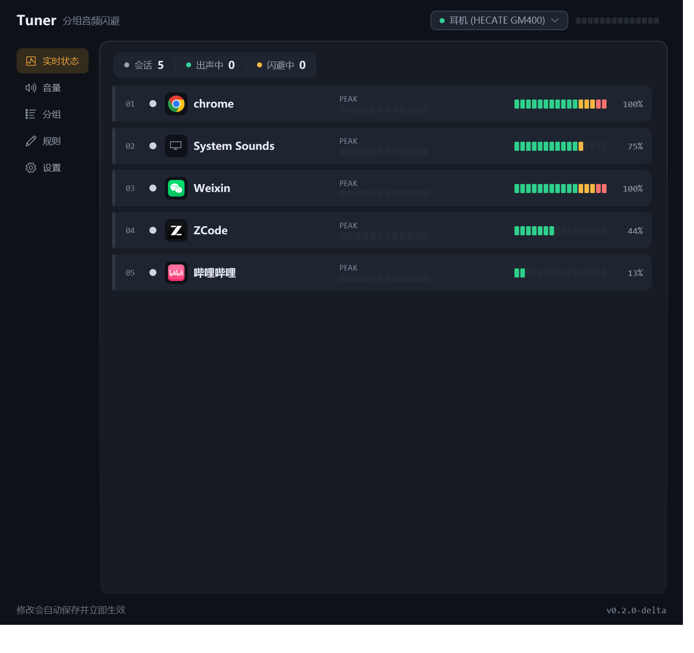
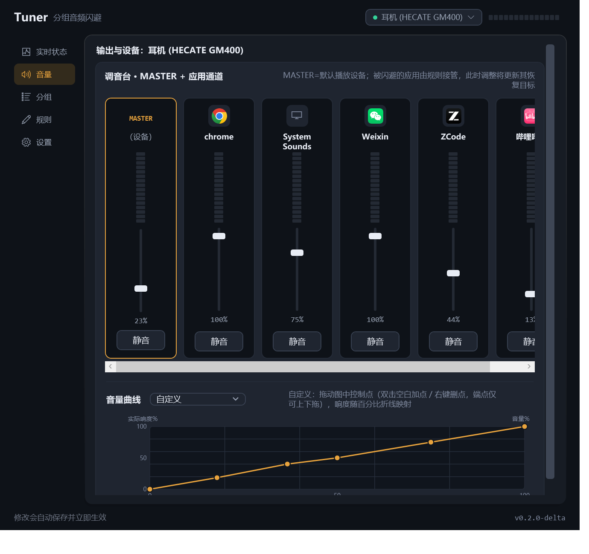
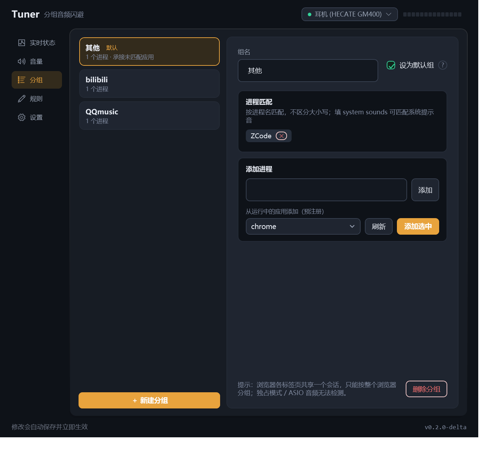
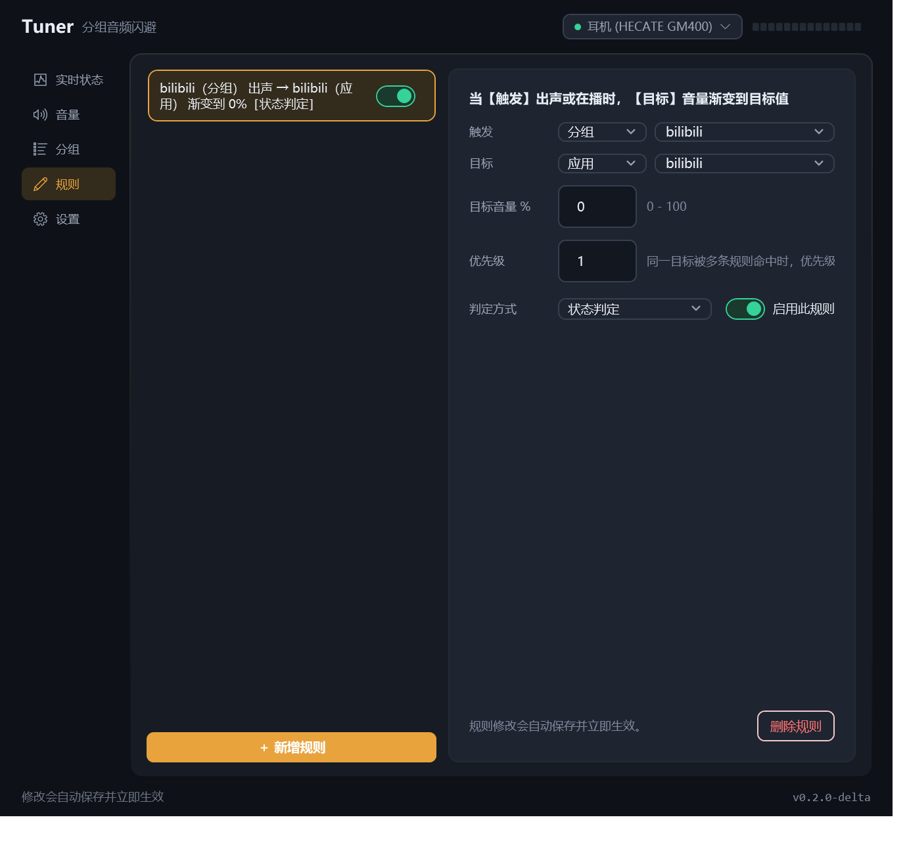
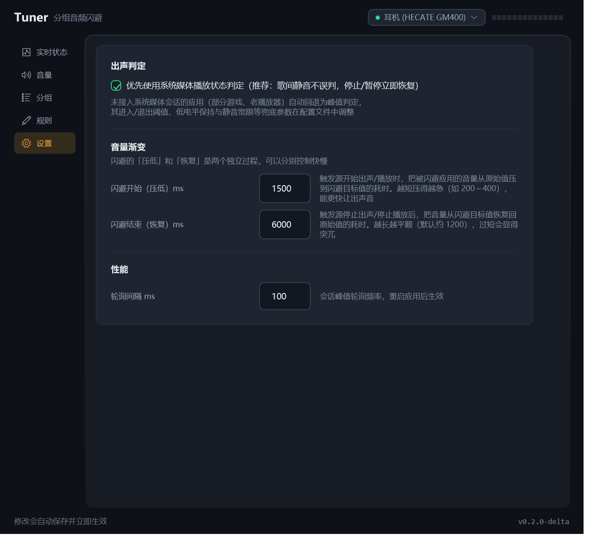

# Tuner — Windows 应用分组音频闪避工具

当某个分组的音频应用出声时，自动把其他分组应用的音量平滑降低（闪避 / ducking）；对方停止发声后平滑恢复。
纯用户态实现（WASAPI，经 NAudio 访问），免驱动、免管理员权限。

典型场景：看视频时自动压低音乐播放器，视频停了音乐自动恢复——不用再手动调音量。

## 下载

从 [Releases](https://github.com/woodtong/Tuner/releases) 下载（Windows 10/11 x64，解压即用，自带 .NET 8 运行时，免安装、免管理员）：

- `Tuner-v0.1.1-win-x64.zip` — 主程序（托盘应用）
- `Tuner-Console-v0.1.1-win-x64.zip` — 控制台诊断工具（可选：实时表格 / `--selftest` 自测 / `--setvol`）

## 界面预览

| 实时状态 | 音量（调音台） |
|---|---|
|  |  |

| 分组 | 规则 | 设置 |
|---|---|---|
|  |  |  |

## 使用步骤

1. 托盘双击打开主界面 →「分组」页：新建分组，把进程名加进去（可从"运行中的应用"直接选，即预注册）；默认组承接所有未匹配应用；填 `system sounds` 可匹配系统提示音。
2. 「规则」页：新增规则——当【触发】出声 → 【目标】音量渐变到 N%；触发/目标可选分组或单个应用，可配优先级与判定方式（状态判定推荐 / 声音判定）。
3. 「音量」页：调音台实时调节 MASTER 与各应用音量，可选拖动手感（音量曲线：线性 / 平方 / 对数等响度 / 自定义）。
4. 「设置」页：闪避开始/结束时长（压低与恢复独立调节，默认 400/1200ms）、轮询间隔等。
5. 修改自动保存并立即生效；关闭窗口 = 最小化到托盘；托盘右键退出时还原全部被修改的音量。

配置文件：`%APPDATA%\Tuner\config.json`（自动加载/保存；损坏时自动回退备份）。

## 已知限制

- 仅监控**默认播放设备（Multimedia 角色）**；"默认通信设备"独立的场景（通话走另一耳机）暂不覆盖。
- 浏览器多标签共享一个会话（系统限制）；独占模式/ASIO 检测不到（不做适配）。
- 从未打开过音频流的应用系统层面不可见——用界面"从运行中的应用添加（预注册）"兜底。
- 闪避期间用户手动调整被闪避应用的音量会被渐变覆盖（此时调整会更新其恢复目标）；恢复完成后不受影响。

## 版本

| 版本 | 内容 |
|---|---|
| **v0.1.1**（2026-10-18，当前） | v0.1 以来的全部迭代合并发布，**替代 v0.1**（旧版已下架）。要点：自研应用图标；闪避开始/结束时长解耦；规则触发/目标可选"应用"方式；**音量曲线**（线性 / 平方 / 对数等响度 / 自定义，曲线图可视化编辑）；**界面整体重设计**（材质分层：悬浮内容面板 / 胶囊导航 / 表面色差层级）；引擎与界面性能优化；配置原子写入 + 备份回退；防抖自动保存 |
| v0.1（2026-10-08） | 首个公开版本（MVP）：分组闪避引擎 + WPF 托盘应用 + 调音台界面 |

## 开发

环境：Windows 10/11 + .NET 8 SDK。内部实现要点与踩坑记录见 [docs/dev-notes.md](docs/dev-notes.md)。

```bash
dotnet build -c Release

# 托盘应用（主程序）
dotnet run --project src/Tuner.App -c Release

# 控制台诊断：实时表格 / 日志模式 / 全链路自测 / 调音量
dotnet run --project src/Tuner.Console -c Release
dotnet run --project src/Tuner.Console -c Release -- --log --interval 50
dotnet run --project src/Tuner.Console -c Release -- --selftest
dotnet run --project src/Tuner.Console -c Release -- --setvol qqmusic 61
```

### 目录结构

```
Tuner.sln
config/test-ducking.json     自动化验收用测试配置
src/
  Tuner.Core/                核心库（UI 无关）：会话监控 / 闪避引擎 / 配置
  Tuner.Console/             控制台诊断工具
  Tuner.App/                 WPF 托盘应用（Tuner.exe）
```

### 打包发布

```bash
# 主程序（自包含单文件），输出目录以实际版本号命名
dotnet publish src/Tuner.App -c Release -r win-x64 --self-contained true `
  -p:PublishSingleFile=true -p:IncludeNativeLibrariesForSelfExtract=true `
  -p:EnableCompressionInSingleFile=true -p:DebugType=none -p:DebugSymbols=false `
  -o dist/Tuner-<版本>-win-x64

# 控制台诊断：同参数，输出到 dist/Tuner-Console-<版本>-win-x64
```

版本号统一在 `src/Directory.Build.props`（四个工程共用）。
