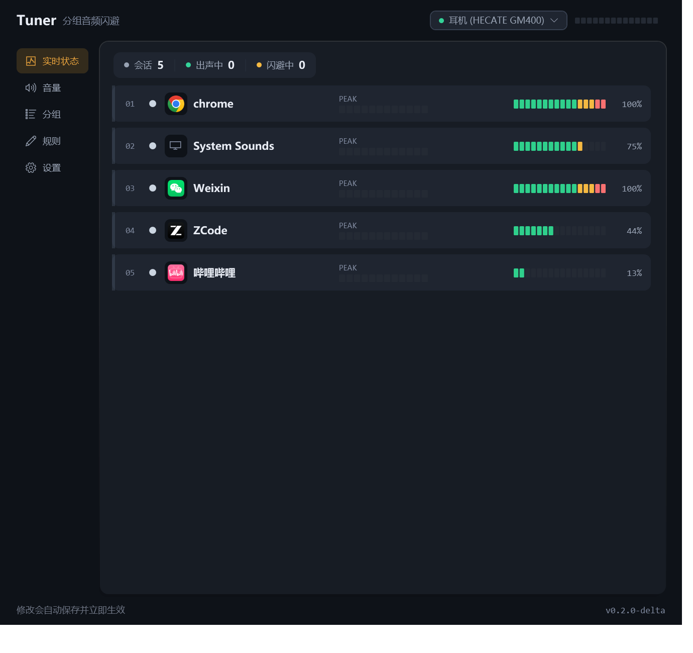
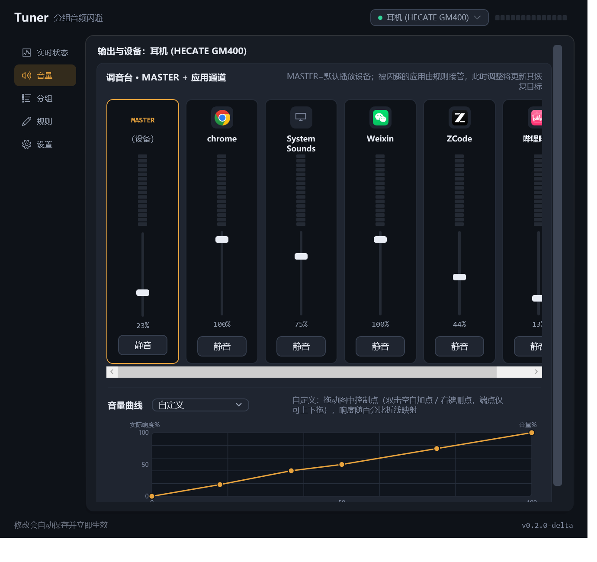
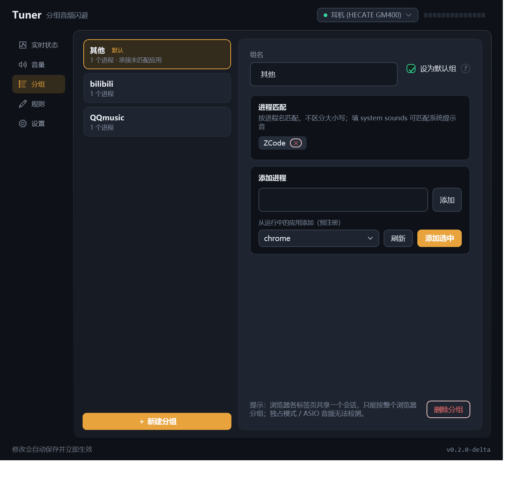
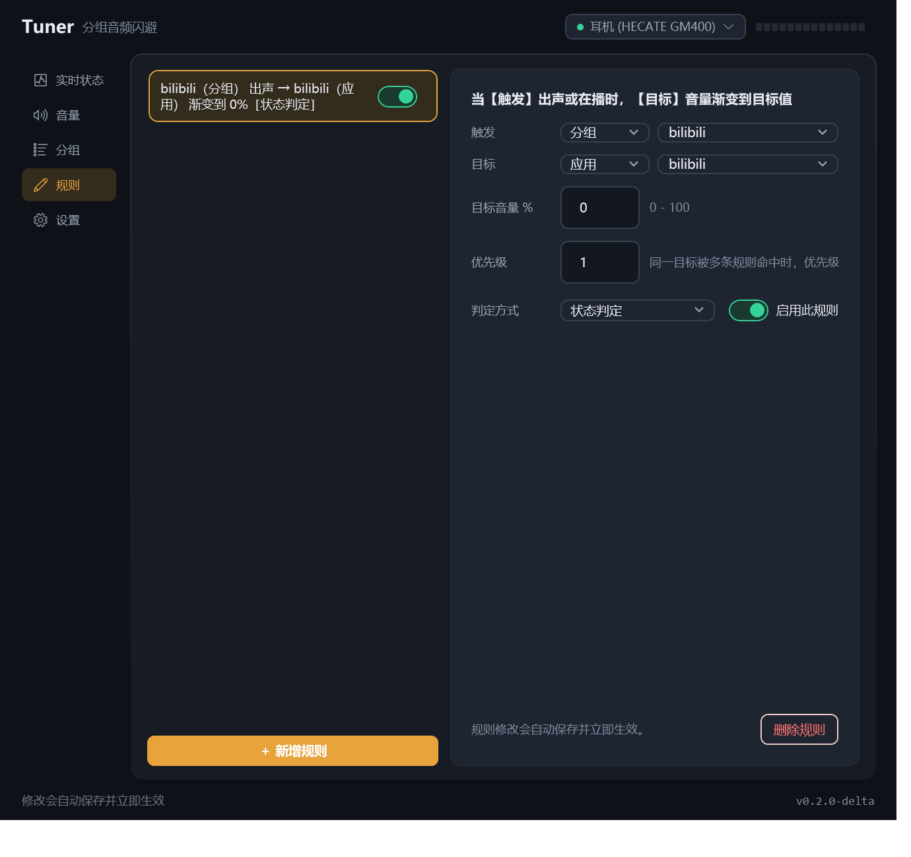
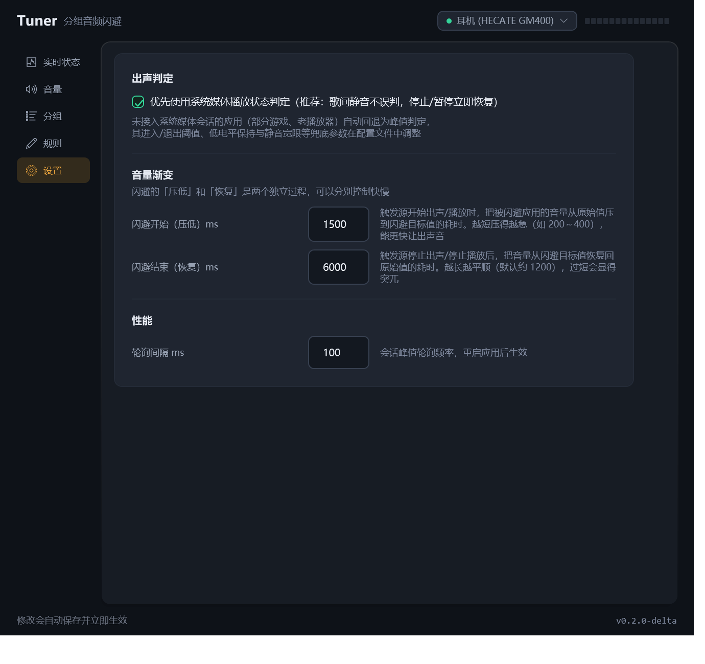

# Tuner — Windows 应用分组音频闪避工具

当某个分组的音频应用出声时，自动把其他分组应用的音量平滑降低（闪避 / ducking）；对方停止发声后平滑恢复。
纯用户态实现（WASAPI，经 NAudio 访问），免驱动、免管理员权限。

典型场景：看视频时自动压低音乐播放器，视频停了音乐自动恢复——不用再手动调音量。

## 下载

从 [Releases](https://github.com/woodtong/Tuner/releases) 下载（Windows 10/11 x64，解压即用，自带 .NET 8 运行时，免安装、免管理员）：

- `Tuner-v0.1.1-win-x64.zip` — 主程序（托盘应用）
- `Tuner-Console-v0.1.1-win-x64.zip` — 控制台诊断工具（可选：实时表格 / `--selftest` 自测 / `--setvol`）

本地的已发布包副本在 `release/windows/v0.1.1/`。

## 界面预览

| 实时状态 | 音量（调音台） |
|---|---|
|  |  |

| 分组 | 规则 | 设置 |
|---|---|---|
|  |  |  |

## 使用步骤

1. 托盘双击打开主界面 →「分组」页：新建分组，把进程名加进去（可从"运行中的应用"直接选，即预注册）；默认组承接所有未匹配应用；填 `system sounds` 可匹配系统提示音。
2. 「规则」页：新增规则——当【触发】出声 → 【目标】音量渐变到 N%；触发/目标可选分组或单个应用，可配优先级与判定方式（状态判定推荐 / 声音判定）。
3. 「音量」页：调音台实时调节 MASTER 与各应用音量，可选拖动手感（音量曲线：线性 / 平方 / 对数等响度 / 自定义）。
4. 「设置」页：闪避开始/结束时长（压低与恢复独立调节，默认 400/1200ms）、轮询间隔等。
5. 修改自动保存并立即生效；关闭窗口 = 最小化到托盘；托盘右键退出时还原全部被修改的音量。

配置文件：`%APPDATA%\Tuner\config.json`（自动加载/保存；损坏时自动回退备份）。

## 已知限制

- 仅监控**默认播放设备（Multimedia 角色）**；"默认通信设备"独立的场景（通话走另一耳机）暂不覆盖。
- 浏览器多标签共享一个会话（系统限制）；独占模式/ASIO 检测不到（不做适配）。
- 从未打开过音频流的应用系统层面不可见——用界面"从运行中的应用添加（预注册）"兜底。
- 闪避期间用户手动调整被闪避应用的音量会被渐变覆盖（此时调整会更新其恢复目标）；恢复完成后不受影响。

## 版本

当前公开版本 **v0.1.1**（2026-10-18）。完整历史见 [CHANGELOG.md](CHANGELOG.md)。

> 版本号单一来源是 `src/Directory.Build.props`（开发期为 `0.1.1-eta`）；正式版以 `main` 上的 tag 与 GitHub Releases 为准。

## 仓库结构

```
Tuner/
├─ Tuner.sln                    解决方案（8 个工程）
├─ README.md                    本文件：项目说明 + 目录地图（唯一入口）
├─ CHANGELOG.md                 版本历史
├─ src/                         源码
│  ├─ Tuner.Core/               核心库（跨平台）：闪避引擎 / 配置 / 音量曲线 + 平台接口
│  ├─ Tuner.Core.Windows/       Windows 平台层（WASAPI 会话监控 / SMTC 状态）
│  ├─ Tuner.Core.Linux/         Linux 平台层（PulseAudio，P/Invoke libpulse）
│  ├─ Tuner.App/                WPF 托盘应用（Tuner.exe，Windows 主程序）
│  ├─ Tuner.App.Avalonia/       Avalonia 跨平台 UI（Linux 主用；macOS 已撤下）
│  ├─ Tuner.Console/            控制台诊断工具
│  ├─ Tuner.PauseProbe/         SMTC「暂停目标应用」探针
│  └─ Tuner.LinuxProbe/         Linux 音频层探针
├─ docs/                        说明文档：实现细节 / 计划 / 验证记录 / 截图（索引见 docs/README.md）
├─ tools/                       开发脚本：图标生成、主题 token、UI 校验
├─ tests/fixtures/              测试夹具（test-ducking.json 自动化验收配置）
├─ release/                     已发布制品（不入库）
│  ├─ windows/v0.1.1/           GitHub Releases v0.1.1 的主程序 + 控制台包
│  └─ linux/                    暂无（Linux 尚未发布正式版）
├─ dev/                         开发版制品（不入库）
│  ├─ windows/v0.1.1-eta/       主程序 + 控制台诊断
│  └─ linux/v0.1.1-eta/         Avalonia 版
└─ archive/                     弃用实验（不入库，可整目录删除）
```

**制品三者分工**（`release/`、`dev/`、`archive/` 都被 `.gitignore` 排除，不进 Git）：

| 目录 | 放什么 | 命名 |
|---|---|---|
| `release/<平台>/<版本>/` | 已发布到 GitHub Releases 的正式包 | 与 tag 一致，如 `v0.1.1` |
| `dev/<平台>/<版本>/` | 开发/内测构建 | 如 `v0.1.1-eta` |
| `archive/` | 判定弃用的实验包（当前是 2026-10-24 白色主题重设计，201 MB） | — |

每个版本目录内同时保留「解压目录 + 同名 zip」；Windows 的控制台诊断工具与主程序放在同一版本目录下。

## 开发

环境：Windows 10/11 + .NET 8 SDK。内部实现要点与踩坑记录见 [docs/dev-notes.md](docs/dev-notes.md)，文档总索引见 [docs/README.md](docs/README.md)。

```bash
dotnet build -c Release

# 托盘应用（主程序）
dotnet run --project src/Tuner.App -c Release

# 控制台诊断：实时表格 / 日志模式 / 全链路自测 / 调音量
dotnet run --project src/Tuner.Console -c Release
dotnet run --project src/Tuner.Console -c Release -- --log --interval 50
dotnet run --project src/Tuner.Console -c Release -- --selftest
dotnet run --project src/Tuner.Console -c Release -- --setvol qqmusic 61
```

### 分支模型（2026-11-05 起）

```
main            稳定线：只接受来自开发线的合并，保持随时可发布
├─ dev/windows  Windows 开发线（WPF 主线，src/Tuner.App + src/Tuner.Core.Windows）
└─ dev/linux    Linux 开发线（Avalonia，src/Tuner.App.Avalonia + src/Tuner.Core.Linux）
```

- 细小功能/修复一律从所属开发线派生短命分支：`feat/<描述>`、`fix/<描述>`、`docs/<描述>`、`refactor/<描述>`，合并回开发线后删除。
- **共享核心**（`src/Tuner.Core`、配置模型）的改动基于 `dev/windows`（主线）进行，再以 merge 或 cherry-pick 同步到 `dev/linux`，避免双向漂移。
- 开发线阶段性稳定后合并进 `main` 并打 tag（如 `v0.1.1`）。
- 单端开发就切到对应开发线工作，不要直接提交 `main`。详细操作见 [docs/git-workflow.md](docs/git-workflow.md)。

### 打包发布

版本号统一在 `src/Directory.Build.props`。产物统一输出到 `dev/<平台>/<版本>/`，正式发布时再挪进 `release/<平台>/<版本>/`。

```bash
# 主程序（自包含单文件）
dotnet publish src/Tuner.App -c Release -r win-x64 --self-contained true `
  -p:PublishSingleFile=true -p:IncludeNativeLibrariesForSelfExtract=true `
  -p:EnableCompressionInSingleFile=true -p:DebugType=none -p:DebugSymbols=false `
  -o dev/windows/<版本>/Tuner-<版本>-win-x64

# 控制台诊断：同参数，输出到 dev/windows/<版本>/Tuner-Console-<版本>-win-x64

# 跨平台 UI（Avalonia）：linux 目标必须显式 -f net8.0；单文件发布不内嵌 libSkiaSharp，用目录发布
dotnet publish src/Tuner.App.Avalonia -c Release -f net8.0 -r linux-x64 --self-contained true `
  -o dev/linux/<版本>/Tuner-Avalonia-<版本>-linux-x64
```

打包后把目录压成同名 zip 放在同一版本目录下；确认可发布，再把整个版本目录移到 `release/<平台>/<版本>/`。
